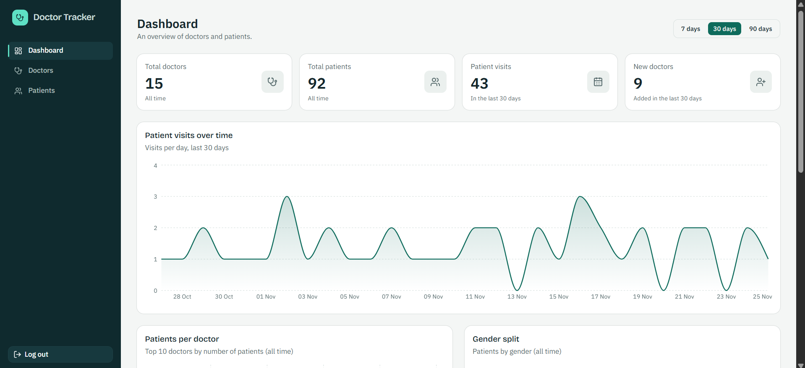
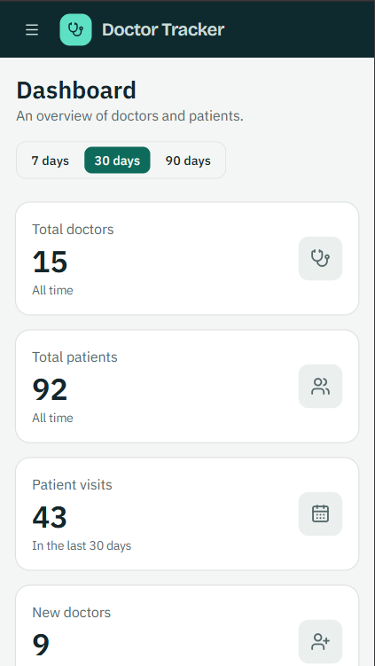
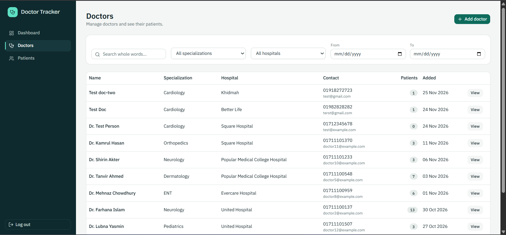
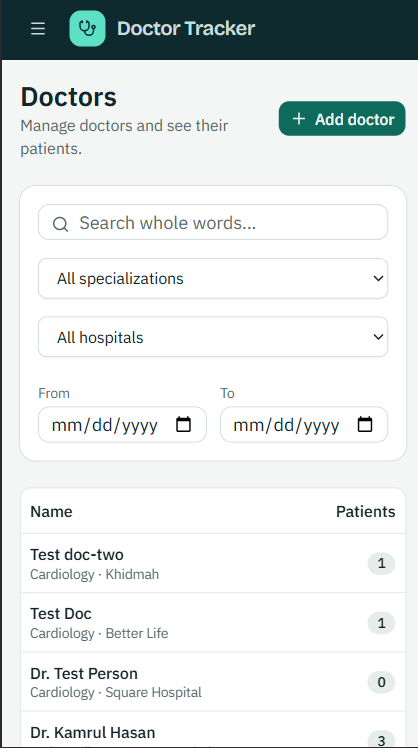
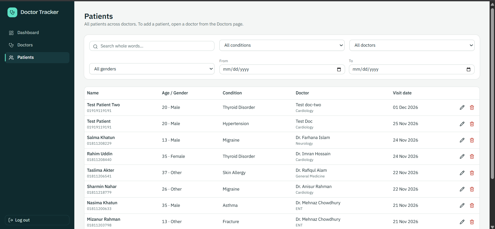
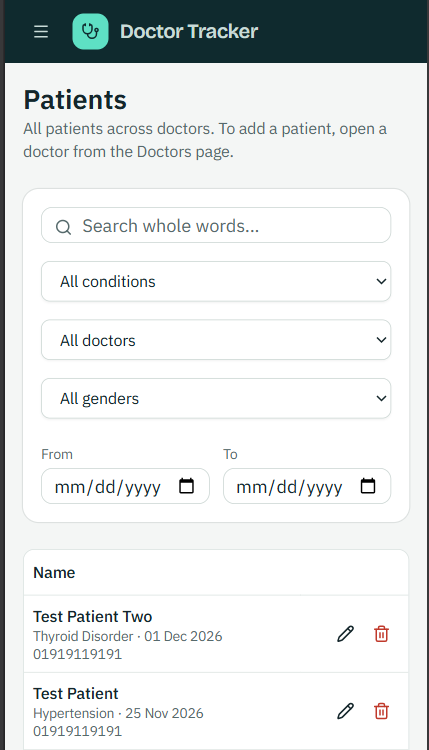
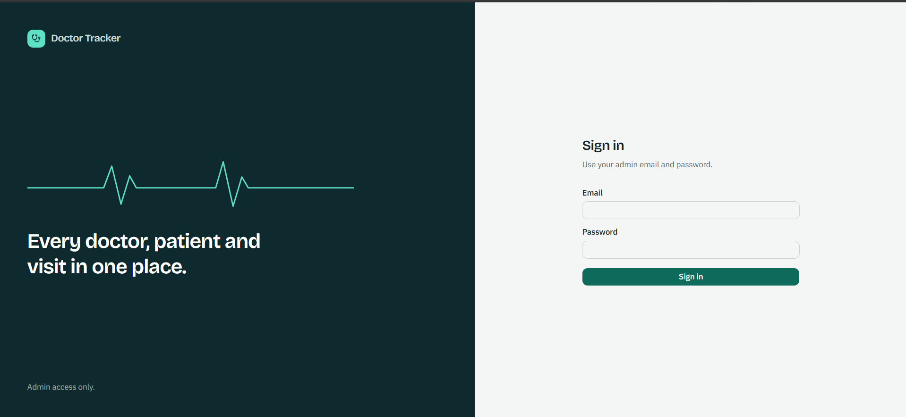
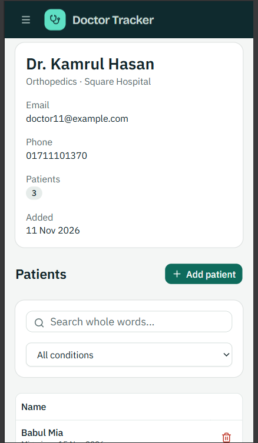
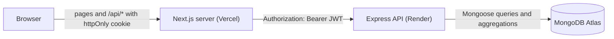

# Doctor Tracker

Doctor Tracker is a secure admin web app for managing doctors and their patients. An authenticated admin can create doctors, add and remove patients under each doctor, search and filter every list, and read a dashboard of totals, patients per doctor and visit trends. Search, filtering and pagination all run on the server against indexed MongoDB queries, so the app stays fast as the data grows.

- **Live app:** https://doctor-tracker-frontend-nine.vercel.app
- **Live API:** https://doctor-tracker-backend-lwtc.onrender.com/api/health
- **Frontend repo:** https://github.com/Romel04/doctor-tracker-frontend (this repo)
- **Backend repo:** https://github.com/Romel04/doctor-tracker-backend
- **Demo login:** sent in the submission email.

> The API runs on Render's free tier and sleeps when idle. The first request after a quiet period can take 30-60 seconds.

## Screenshots

| Desktop | Mobile |
| --- | --- |
|  |  |
|  |  |
|  |  |
|  |  |

## Features

- **Authentication:** login page, httpOnly cookie session, every page and API call protected.
- **Doctors:** create, list, search, filter (specialization, hospital, date range), paginate, open a doctor to see their patients, add a patient, delete a patient.
- **Patients:** dedicated page with list, edit, delete, pagination, search, and filters (condition, gender, doctor, visit date range).
- **Dashboard:** total doctors and patients, patients per doctor, patients over time, conditions, gender split and specializations. The date range is selectable.
- **UI:** responsive layout with a sidebar on desktop and a slide-over menu on mobile, loading skeletons, empty states, toasts and form validation.

## Tech stack

| Layer | Choice |
| --- | --- |
| Frontend | Next.js 16 (App Router), React 19, TypeScript, Tailwind CSS 4, shadcn/ui |
| Data fetching | TanStack Query v5 |
| Forms | React Hook Form + Zod |
| Charts | Recharts |
| Backend | Node.js, Express, TypeScript, Mongoose, Zod, JWT, bcryptjs |
| Database | MongoDB Atlas |
| Hosting | Vercel (frontend), Render (backend) |

## Setup guide

You need Node.js 20+ and a MongoDB database (a free Atlas M0 cluster works).

### 1. Start the backend

```bash
git clone https://github.com/Romel04/doctor-tracker-backend
cd doctor-tracker-backend
npm install
cp .env.example .env      # on Windows PowerShell: copy .env.example .env
```

Open `.env` and fill in `MONGO_URI`, `JWT_SECRET`, `ADMIN_EMAIL` and `ADMIN_PASSWORD`. Then run:

```bash
npm run seed        # creates the admin user
npm run seed:demo   # optional: 12 doctors and 90 patients (WIPES doctors and patients)
npm run dev         # API on http://localhost:5000
```

Check `http://localhost:5000/api/health`. It should return `{"status":"ok", ...}`.

### 2. Start the frontend

```bash
git clone https://github.com/Romel04/doctor-tracker-frontend
cd doctor-tracker-frontend
npm install
cp .env.example .env.local    # on Windows PowerShell: copy .env.example .env.local
npm run dev                   # app on http://localhost:3000
```

Open http://localhost:3000 and log in with the `ADMIN_EMAIL` and `ADMIN_PASSWORD` you set in the backend `.env`.

### Environment variables

| Where | Variable | Purpose |
| --- | --- | --- |
| Frontend | `BACKEND_API_URL` | Base URL of the Express API, for example `http://localhost:5000/api`. Read by the Next server only, never sent to the browser. |
| Backend | `PORT` | API port (default 5000). |
| Backend | `MONGO_URI` | MongoDB connection string. |
| Backend | `JWT_SECRET` | Secret used to sign login tokens. |
| Backend | `JWT_EXPIRES_IN` | Token lifetime, for example `1d`. |
| Backend | `CLIENT_URL` | Frontend origin allowed by CORS. |
| Backend | `ADMIN_EMAIL`, `ADMIN_PASSWORD` | Credentials for the admin created by `npm run seed`. |

## System architecture



**Login flow**

1. The login form posts to the Next route `/api/auth/login`.
2. That route calls `POST /api/auth/login` on Express. Express checks the bcrypt-hashed password and returns a signed JWT.
3. The Next route stores the JWT in an httpOnly cookie (`dt_token`) and returns only a success message to the browser.

**Every later request**

1. The browser calls `/api/backend/...` on the Next server, and the cookie goes with it.
2. The route handler `src/app/api/backend/[...path]/route.ts` reads the cookie and forwards the request to Express with `Authorization: Bearer <token>`.
3. Express validates the token and the request body (Zod), runs the query, and returns JSON. A `401` clears the cookie.

**Route protection** has two layers. `src/proxy.ts` (the Next 16 name for middleware) redirects logged-out users to `/login`, and the `(app)` layout checks the cookie again on the server.

**Frontend structure**

```
src/
  app/            routes: login, (app)/dashboard, doctors, doctors/[id], patients, api/*
  components/     app shell, shared filters and pagination, feature folders (doctors, patients, dashboard)
  lib/            api client, types, validators, formatting, chart theme, cache invalidation
  hooks/          useDebounce
  proxy.ts        route protection
```

**Backend structure:** `routes` call `controllers`. `validators` (Zod) and `middleware` (auth, validate, error handler) sit in front, `models` define the Mongoose schemas and indexes, and `utils` holds shared helpers.

## Technical decisions

### 1. Session in an httpOnly cookie, behind a Next.js proxy

**Decision:** the browser never talks to the Express API directly. The JWT lives in an httpOnly cookie, and a Next route handler attaches it as a Bearer token.

**Why:**
- **XSS:** a token in `localStorage` can be stolen by any injected script. An httpOnly cookie cannot be read by JavaScript at all.
- **No CORS setup:** the browser only calls its own origin, so there is nothing to configure or get wrong.
- **Hidden backend:** the Render URL and the raw token never reach the client.
- **Simple protection:** the proxy and the server layout can check for the cookie before any page renders.

**Trade-offs:** each request takes one extra hop through the Next server. The cookie is `sameSite=lax`, which blocks cross-site request forgery for state-changing requests. The Express API stays a standard Bearer-token REST API, so other clients can still use it.

### 2. Server-side search, filters and pagination backed by indexes

**Decision:** every list endpoint takes `page`, `limit`, search and filter parameters and returns one page plus pagination info. The frontend only ever holds one page of rows.

**Why:**
- **Indexes match the queries:**

  | Collection | Index | Serves |
  | --- | --- | --- |
  | Doctor | text (name, specialization, hospital) | search |
  | Doctor | (specialization, createdAt), (hospital, createdAt), createdAt | filters plus date range, sorted newest first |
  | Patient | (doctor, visitDate) | a doctor's patients, sorted by visit |
  | Patient | (condition, visitDate), visitDate | condition filter and date range |
  | Patient | text (name, condition) | search |

- **No N+1 queries:** the doctors list needs a patient count per doctor. One grouped aggregation covers all doctors on the current page, instead of one count per doctor.
- **Cheap dashboard joins:** the "patients per doctor" aggregation groups, sorts and limits to the top 10 before `$lookup`, so the join runs for 10 doctors rather than all of them. Daily counts use `$dateToString` with the `Asia/Dhaka` timezone, and days with zero visits are filled in so the chart has no gaps.
- **Smooth UI:** TanStack Query keeps the previous page on screen while the next one loads, search input is debounced, and add, edit and delete actions invalidate only the affected query keys.

**Trade-off:** MongoDB text indexes match whole words only. Searching "cardio" will not match "cardiology". That is the price of an index-backed search without a separate search engine. Atlas Search or a prefix index would be the next step if partial matching mattered.

## Scalability considerations

- **Server-side pagination everywhere**, so response size and browser memory stay constant as data grows.
- **Indexes designed for the actual filters and sort orders**, so queries do not scan whole collections.
- **Stateless backend:** JWTs are verified without session storage, so the API can run as many instances as needed behind a load balancer.
- **Lean reads:** list queries use `.lean()` and fetch only the fields they need.
- **Client caching:** TanStack Query caches pages and reference data (filter options, conditions) with `staleTime`, so repeat views cost no requests.
- **Next steps if needed:** cursor-based pagination for very deep pages, Atlas Search for partial-word matching, and caching the dashboard aggregation.

## Scripts

| Command | What it does |
| --- | --- |
| `npm run dev` | Start the dev server |
| `npm run build` | Production build |
| `npm start` | Run the production build |
| `npm run lint` | Run ESLint |

## Author

Eakhlasur Rahman (Romel)